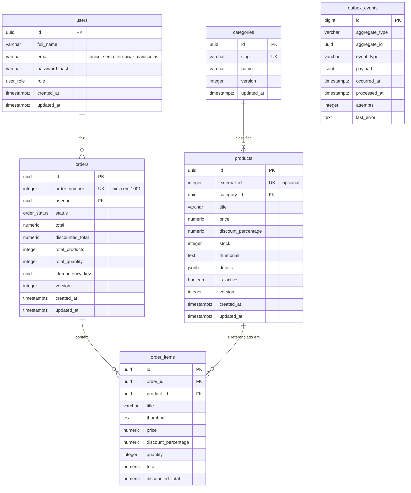

# Modelagem PostgreSQL

O PostgreSQL é o banco de escrita e a fonte da verdade. O DDL executável está em `schema.sql`.

## Modelagem

`outbox_events` não tem chave estrangeira. Ela aponta para um registro pela dupla `aggregate_type` e `aggregate_id`.

O carrinho e a sessão não têm tabela, pois ficam no Redis.

## Identificadores

- As chaves primárias de negócio e as referências a elas são **UUID v4**. O padrão do banco é `gen_random_uuid()`.
- `orders.order_number` é o número exibido ao usuário. A sequência pode ter lacunas, por exemplo após uma transação desfeita.
- `outbox_events.id` continua `bigint`, por ser um id interno usado na leitura da fila.
- UUID não substitui autorização: a aplicação deve impedir o acesso a pedidos de outro usuário.

## Critério para colunas de produto

Um dado de produto é **coluna** quando participa de transação, relacionamento ou controle. Os atributos apenas descritivos ficam juntos em `details` (`jsonb`).

`title` e `thumbnail` são colunas porque são copiados para o item do pedido.

## Tipos enumerados

| Tipo | Valores |
|---|---|
| `user_role` | `admin`, `user` |
| `order_status` | `PROCESSING`, `DELIVERED` |

## Tabelas

Nas tabelas abaixo, **Nulo = não** significa `NOT NULL`.

### users

Usuários do sistema: administrador e comprador.

| Coluna | Tipo | Nulo | Padrão | Descrição |
|---|---|---|---|---|
| `id` | `uuid` | não | `gen_random_uuid()` | Identificador |
| `full_name` | `varchar(150)` | não | | Nome completo |
| `email` | `varchar(254)` | não | | E-mail de login |
| `password_hash` | `varchar(255)` | não | | Hash da senha |
| `role` | `user_role` | não | `'user'` | Papel |
| `created_at` | `timestamptz` | não | `now()` | Criação |
| `updated_at` | `timestamptz` | não | `now()` | Última alteração |

| Constraint ou índice | Definição |
|---|---|
| `users_pkey` | `PRIMARY KEY (id)` |
| `users_email_uq` | índice único em `lower(email)` |

### categories

| Coluna | Tipo | Nulo | Padrão | Descrição |
|---|---|---|---|---|
| `id` | `uuid` | não | `gen_random_uuid()` | Identificador |
| `slug` | `varchar(60)` | não | | Chave textual usada em filtros |
| `name` | `varchar(80)` | não | | Nome exibido |
| `version` | `integer` | não | `1` | Controle da sincronização com o MongoDB |
| `updated_at` | `timestamptz` | não | `now()` | Última alteração |

| Constraint | Definição |
|---|---|
| `categories_pkey` | `PRIMARY KEY (id)` |
| `categories_slug_key` | `UNIQUE (slug)` |

### products

| Coluna | Tipo | Nulo | Padrão | Descrição |
|---|---|---|---|---|
| `id` | `uuid` | não | `gen_random_uuid()` | Identificador |
| `external_id` | `integer` | sim | | Id do produto no sistema de origem; nulo se criado no próprio sistema |
| `category_id` | `uuid` | não | | Categoria |
| `title` | `varchar(150)` | não | | Nome do produto |
| `price` | `numeric(10,2)` | não | | Preço unitário |
| `discount_percentage` | `numeric(5,2)` | não | `0` | Percentual de desconto |
| `stock` | `integer` | não | | Quantidade em estoque |
| `thumbnail` | `text` | não | | URL da miniatura |
| `details` | `jsonb` | não | `'{}'` | Atributos descritivos |
| `is_active` | `boolean` | não | `true` | `false` retira o produto de venda sem apagá-lo |
| `version` | `integer` | não | `1` | Controle da sincronização com o MongoDB |
| `created_at` | `timestamptz` | não | `now()` | Criação |
| `updated_at` | `timestamptz` | não | `now()` | Última alteração |

| Constraint ou índice | Definição |
|---|---|
| `products_pkey` | `PRIMARY KEY (id)` |
| `products_external_id_key` | `UNIQUE (external_id)`; permite vários nulos |
| `products_category_id_fkey` | `FOREIGN KEY (category_id) REFERENCES categories (id)` |
| `products_price_check` | `price >= 0` |
| `products_discount_percentage_check` | `discount_percentage` entre 0 e 100 |
| `products_stock_check` | `stock >= 0` |
| `products_details_check` | `details` é um objeto JSON |
| `products_category_idx` | índice em `category_id` |

Chaves previstas em `details`. O banco não valida o conteúdo nem exige as chaves; as regras de entrada estão em `06-contrato-api.md`.

| Chave | Formato |
|---|---|
| `description` | texto |
| `rating` | número |
| `brand` | texto, opcional |
| `sku` | texto |
| `weight` | número |
| `dimensions` | objeto `{ width, height, depth }` |
| `warrantyInformation`, `shippingInformation`, `returnPolicy` | texto |
| `minimumOrderQuantity` | número inteiro |
| `tags` | lista de textos |
| `images` | lista de URLs, na ordem de exibição |
| `reviews` | lista de `{ rating, comment, date, reviewerName, reviewerEmail }` |
| `meta` | objeto `{ barcode, qrCode }` |

### orders

| Coluna | Tipo | Nulo | Padrão | Descrição |
|---|---|---|---|---|
| `id` | `uuid` | não | `gen_random_uuid()` | Identificador |
| `order_number` | `integer` identity (`ALWAYS`), inicia em 1001 | não | gerado | Número exibido do pedido |
| `user_id` | `uuid` | não | | Comprador |
| `status` | `order_status` | não | `'PROCESSING'` | Situação |
| `total` | `numeric(12,2)` | não | | Total a preço cheio, que é o valor cobrado |
| `discounted_total` | `numeric(12,2)` | não | | Total com desconto |
| `total_products` | `integer` | não | | Quantidade de produtos distintos |
| `total_quantity` | `integer` | não | | Soma das quantidades |
| `idempotency_key` | `uuid` | não | | Evita um segundo pedido em novas tentativas com a mesma chave |
| `version` | `integer` | não | `1` | Controle da sincronização |
| `created_at` | `timestamptz` | não | `now()` | Data da compra |
| `updated_at` | `timestamptz` | não | `now()` | Última alteração |

| Constraint ou índice | Definição |
|---|---|
| `orders_pkey` | `PRIMARY KEY (id)` |
| `orders_order_number_key` | `UNIQUE (order_number)` |
| `orders_user_id_fkey` | `FOREIGN KEY (user_id) REFERENCES users (id)` |
| `orders_total_check` | `total >= 0` |
| `orders_discounted_total_check` | `discounted_total >= 0` |
| `orders_total_products_check` | `total_products > 0` |
| `orders_total_quantity_check` | `total_quantity > 0` |
| `orders_user_id_idempotency_key_key` | `UNIQUE (user_id, idempotency_key)` |
| `orders_user_idx` | índice em `(user_id, created_at DESC)` |

### order_items

`title`, `thumbnail`, `price` e `discount_percentage` são cópias do momento da compra. Mudanças no produto não alteram o histórico.

| Coluna | Tipo | Nulo | Padrão | Descrição |
|---|---|---|---|---|
| `id` | `uuid` | não | `gen_random_uuid()` | Identificador |
| `order_id` | `uuid` | não | | Pedido |
| `product_id` | `uuid` | não | | Produto |
| `title` | `varchar(150)` | não | | Nome na compra |
| `thumbnail` | `text` | não | | Miniatura na compra |
| `price` | `numeric(10,2)` | não | | Preço unitário na compra |
| `discount_percentage` | `numeric(5,2)` | não | `0` | Desconto na compra |
| `quantity` | `integer` | não | | Quantidade comprada |
| `total` | `numeric(12,2)` | não | | `price × quantity` |
| `discounted_total` | `numeric(12,2)` | não | | `total` com desconto |

| Constraint | Definição |
|---|---|
| `order_items_pkey` | `PRIMARY KEY (id)` |
| `order_items_order_id_fkey` | `FOREIGN KEY (order_id) REFERENCES orders (id) ON DELETE CASCADE` |
| `order_items_product_id_fkey` | `FOREIGN KEY (product_id) REFERENCES products (id)` |
| `order_items_price_check` | `price >= 0` |
| `order_items_quantity_check` | `quantity > 0` |
| `order_items_order_id_product_id_key` | `UNIQUE (order_id, product_id)` |

### outbox_events

Eventos gravados na mesma transação do dado de negócio e consumidos pelo worker que atualiza o MongoDB.

| Coluna | Tipo | Nulo | Padrão | Descrição |
|---|---|---|---|---|
| `id` | `bigint` identity (`ALWAYS`) | não | gerado | Ordem de processamento |
| `aggregate_type` | `varchar(30)` | não | | Tipo do registro afetado |
| `aggregate_id` | `uuid` | não | | Id do registro afetado |
| `event_type` | `varchar(50)` | não | | Nome do evento |
| `payload` | `jsonb` | não | `'{}'` | Dados extras |
| `occurred_at` | `timestamptz` | não | `now()` | Momento do evento |
| `processed_at` | `timestamptz` | sim | | Nulo enquanto pendente |
| `attempts` | `integer` | não | `0` | Tentativas |
| `last_error` | `text` | sim | | Último erro |

| Constraint ou índice | Definição |
|---|---|
| `outbox_events_pkey` | `PRIMARY KEY (id)` |
| `outbox_events_aggregate_type_check` | `PRODUCT`, `CATEGORY` ou `ORDER` |
| `outbox_pending_idx` | índice em `id`, apenas onde `processed_at IS NULL` |

## Exclusões

| Ação | Efeito |
|---|---|
| Apagar um pedido | Apaga os itens (`CASCADE`) |
| Apagar um usuário com pedidos | Bloqueado pela chave estrangeira |
| Apagar uma categoria com produtos | Bloqueado pela chave estrangeira |
| Apagar um produto já comprado | Bloqueado; use `is_active = false` |

## Reconstrução das views

As views do MongoDB podem ser apagadas e reconstruídas a partir do **estado atual** das tabelas.

- A reconstrução não depende do histórico de `outbox_events`; não se trata de Event Sourcing.
- Eventos já processados podem ser apagados. Os pendentes devem ser mantidos.
- Todo dado de uma view deve vir destas tabelas ou ser calculado a partir delas. Se uma view precisar de um dado novo, ele deve ser gravado primeiro no PostgreSQL.
- O Redis não faz parte da reconstrução. O carrinho existe apenas nele e não pode ser recriado a partir destas tabelas.

O procedimento está em `05-reprocessamento-mongodb.md`.

## Regras que a aplicação precisa garantir

O banco **não** impõe as regras abaixo.

- SKU único e formato das chaves de `details`.
- Totais do item: `total = price × quantity` e `discounted_total = total × (1 − discount_percentage / 100)`, com 2 casas, arredondando metade para cima.
- Totais do pedido iguais à soma dos itens, e `total_products` igual ao número de itens.
- Faixa de `discount_percentage` e valores não negativos nos totais de `order_items`.
- Pedido com pelo menos um item.
- Mudança de status apenas de `PROCESSING` para `DELIVERED`, feita por um `admin`.
- No checkout, baixar o estoque somente se houver quantidade suficiente e o produto estiver ativo, na mesma transação do pedido.
- Atualizar `updated_at` em toda alteração; não há trigger.
- Incrementar `version` em toda alteração de categoria, produto ou pedido. Alterar um item conta como alteração do pedido.
- Gravar o evento em `outbox_events` na mesma transação de toda criação, alteração ou exclusão de categoria, produto ou pedido.
- Se uma mudança em categoria afetar dados copiados nas views de produtos, como nome ou `slug`, incrementar também a `version` desses produtos e gravar um evento para cada um.
- Correções feitas direto no banco seguem as mesmas regras.
