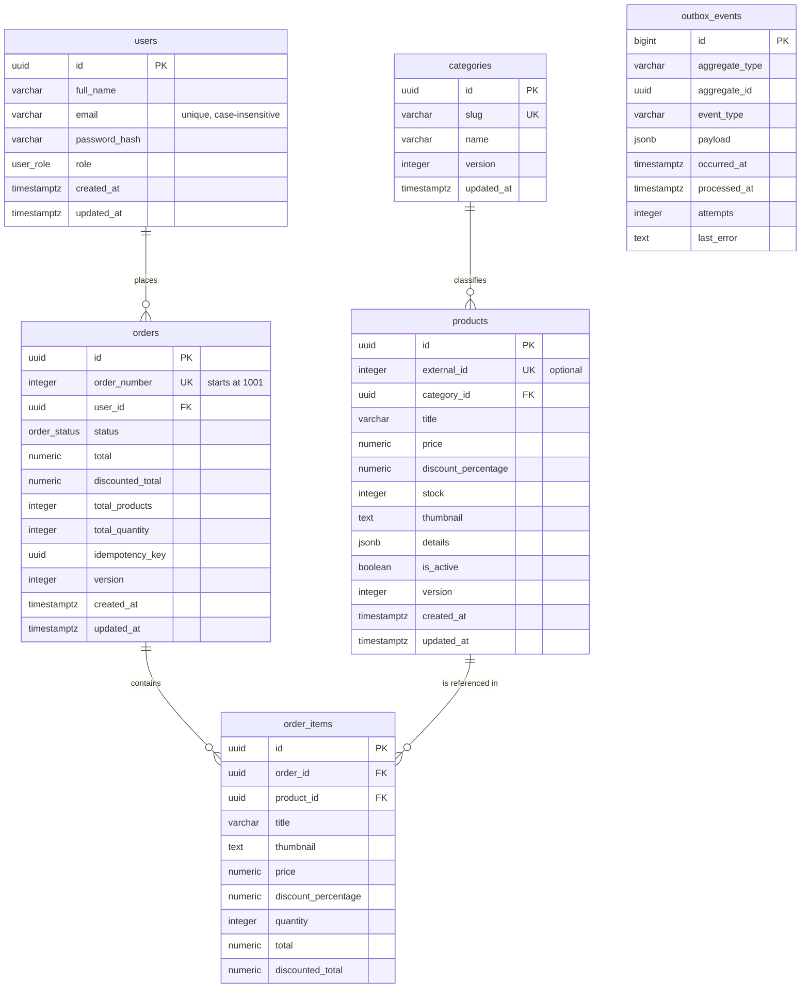

# PostgreSQL Model

PostgreSQL is the write database and the source of truth. The [Prisma schema](../../backend/prisma/schema.prisma) defines the tables, columns, and relationships documented here.

The [Prisma migrations](../../backend/prisma/migrations/) create and evolve the database. Their SQL defines the `CHECK` constraints, the unique index on `lower(email)`, the partial outbox index, and the identity columns, including order numbering starting at 1001.

## Model

`outbox_events` has no foreign key. It points to a record through the pair `aggregate_type` and `aggregate_id`.

The cart and the session have no table, since they live in Redis.

## Identifiers

- Business primary keys and references to them are **UUID v4**. The database default is `gen_random_uuid()`.
- `orders.order_number` is the number shown to the user. The sequence may have gaps, for example after a rolled-back transaction.
- `outbox_events.id` remains `bigint`, since it is an internal id used to read the queue.
- A UUID does not replace authorization: the application must prevent access to other users' orders.

## Criteria for product columns

A product attribute is a **column** when it takes part in a transaction, a relationship or a control mechanism. Purely descriptive attributes are grouped in `details` (`jsonb`).

`title` and `thumbnail` are columns because they are copied into the order item.

## Enumerated types

| Type | Values |
|---|---|
| `user_role` | `admin`, `user` |
| `order_status` | `CONFIRMED` |

An order is stored as `CONFIRMED` when checkout completes, and its status does not change afterwards: this ends the order's lifecycle. There is no administrative order management.

## Tables

In the tables below, **Null = no** means `NOT NULL`.

### users

System users: administrator and shopper.

| Column | Type | Null | Default | Description |
|---|---|---|---|---|
| `id` | `uuid` | no | `gen_random_uuid()` | Identifier |
| `full_name` | `varchar(150)` | no | | Full name |
| `email` | `varchar(254)` | no | | Login e-mail |
| `password_hash` | `varchar(255)` | no | | Password hash; see below |
| `role` | `user_role` | no | `'user'` | Role |
| `created_at` | `timestamptz` | no | `now()` | Creation |
| `updated_at` | `timestamptz` | no | `now()` | Last change |

| Constraint or index | Definition |
|---|---|
| `users_pkey` | `PRIMARY KEY (id)` |
| `users_email_uq` | unique index on `lower(email)` |

`email` is stored in lowercase. Login looks it up with `lower(email) = lower($1)`, which uses `users_email_uq`.

`password_hash` uses scrypt from `node:crypto` (N = 2^15, r = 8, p = 3, 16-byte salt, 64-byte key) in the format `scrypt$N$r$p$salt$key`, with salt and key in `base64url`. Storing the parameters allows changing them later without invalidating existing hashes.

### categories

| Column | Type | Null | Default | Description |
|---|---|---|---|---|
| `id` | `uuid` | no | `gen_random_uuid()` | Identifier |
| `slug` | `varchar(60)` | no | | Text key used in filters |
| `name` | `varchar(80)` | no | | Display name |
| `version` | `integer` | no | `1` | Controls synchronization with MongoDB |
| `updated_at` | `timestamptz` | no | `now()` | Last change |

| Constraint | Definition |
|---|---|
| `categories_pkey` | `PRIMARY KEY (id)` |
| `categories_slug_key` | `UNIQUE (slug)` |

### products

| Column | Type | Null | Default | Description |
|---|---|---|---|---|
| `id` | `uuid` | no | `gen_random_uuid()` | Identifier |
| `external_id` | `integer` | yes | | Product id in the source system; null if created in this system |
| `category_id` | `uuid` | no | | Category |
| `title` | `varchar(150)` | no | | Product name |
| `price` | `numeric(10,2)` | no | | Unit price |
| `discount_percentage` | `numeric(5,2)` | no | `0` | Discount percentage |
| `stock` | `integer` | no | | Quantity in stock |
| `thumbnail` | `text` | no | | Thumbnail URL |
| `details` | `jsonb` | no | `'{}'` | Descriptive attributes |
| `is_active` | `boolean` | no | `true` | `false` takes the product off sale without deleting it |
| `version` | `integer` | no | `1` | Controls synchronization with MongoDB |
| `created_at` | `timestamptz` | no | `now()` | Creation |
| `updated_at` | `timestamptz` | no | `now()` | Last change |

| Constraint or index | Definition |
|---|---|
| `products_pkey` | `PRIMARY KEY (id)` |
| `products_external_id_key` | `UNIQUE (external_id)`; allows multiple nulls |
| `products_category_id_fkey` | `FOREIGN KEY (category_id) REFERENCES categories (id)` |
| `products_price_check` | `price >= 0` |
| `products_discount_percentage_check` | `discount_percentage` between 0 and 100 |
| `products_stock_check` | `stock >= 0` |
| `products_details_check` | `details` is a JSON object |
| `products_category_idx` | index on `category_id` |

Expected keys in `details`. The database does not validate their content or require them; the input rules are in `06-api-contract.md`.

| Key | Format |
|---|---|
| `description` | text |
| `rating` | number |
| `brand` | text, optional |
| `sku` | text |
| `weight` | number |
| `dimensions` | object `{ width, height, depth }` |
| `warrantyInformation` | text |
| `tags` | list of texts |
| `images` | list of URLs, in display order |

### orders

| Column | Type | Null | Default | Description |
|---|---|---|---|---|
| `id` | `uuid` | no | `gen_random_uuid()` | Identifier |
| `order_number` | `integer` identity (`ALWAYS`), starts at 1001 | no | generated | Displayed order number |
| `user_id` | `uuid` | no | | Shopper |
| `status` | `order_status` | no | `'CONFIRMED'` | Status; always `CONFIRMED` |
| `total` | `numeric(12,2)` | no | | Total at full price, which is the amount charged |
| `discounted_total` | `numeric(12,2)` | no | | Discounted total |
| `total_products` | `integer` | no | | Number of distinct products |
| `total_quantity` | `integer` | no | | Sum of quantities |
| `idempotency_key` | `uuid` | no | | Prevents a second order on retries with the same key |
| `version` | `integer` | no | `1` | Controls synchronization |
| `created_at` | `timestamptz` | no | `now()` | Purchase date |
| `updated_at` | `timestamptz` | no | `now()` | Last change |

| Constraint or index | Definition |
|---|---|
| `orders_pkey` | `PRIMARY KEY (id)` |
| `orders_order_number_key` | `UNIQUE (order_number)` |
| `orders_user_id_fkey` | `FOREIGN KEY (user_id) REFERENCES users (id)` |
| `orders_total_check` | `total >= 0` |
| `orders_discounted_total_check` | `discounted_total >= 0` |
| `orders_total_products_check` | `total_products > 0` |
| `orders_total_quantity_check` | `total_quantity > 0` |
| `orders_user_id_idempotency_key_key` | `UNIQUE (user_id, idempotency_key)` |
| `orders_user_idx` | index on `(user_id, created_at DESC)` |

### order_items

`title`, `thumbnail`, `price` and `discount_percentage` are copies taken at purchase time. Changes to the product do not alter the history.

| Column | Type | Null | Default | Description |
|---|---|---|---|---|
| `id` | `uuid` | no | `gen_random_uuid()` | Identifier |
| `order_id` | `uuid` | no | | Order |
| `product_id` | `uuid` | no | | Product |
| `title` | `varchar(150)` | no | | Name at purchase |
| `thumbnail` | `text` | no | | Thumbnail at purchase |
| `price` | `numeric(10,2)` | no | | Unit price at purchase |
| `discount_percentage` | `numeric(5,2)` | no | `0` | Discount at purchase |
| `quantity` | `integer` | no | | Quantity purchased |
| `total` | `numeric(12,2)` | no | | `price × quantity` |
| `discounted_total` | `numeric(12,2)` | no | | `total` with discount |

| Constraint | Definition |
|---|---|
| `order_items_pkey` | `PRIMARY KEY (id)` |
| `order_items_order_id_fkey` | `FOREIGN KEY (order_id) REFERENCES orders (id) ON DELETE CASCADE` |
| `order_items_product_id_fkey` | `FOREIGN KEY (product_id) REFERENCES products (id)` |
| `order_items_price_check` | `price >= 0` |
| `order_items_quantity_check` | `quantity > 0` |
| `order_items_order_id_product_id_key` | `UNIQUE (order_id, product_id)` |

### outbox_events

Events written in the same transaction as the business data and consumed by the worker that updates MongoDB.

| Column | Type | Null | Default | Description |
|---|---|---|---|---|
| `id` | `bigint` identity (`ALWAYS`) | no | generated | Processing order |
| `aggregate_type` | `varchar(30)` | no | | Type of the affected record |
| `aggregate_id` | `uuid` | no | | Id of the affected record |
| `event_type` | `varchar(50)` | no | | Event name |
| `payload` | `jsonb` | no | `'{}'` | Extra data |
| `occurred_at` | `timestamptz` | no | `now()` | Event time |
| `processed_at` | `timestamptz` | yes | | Null while pending |
| `attempts` | `integer` | no | `0` | Attempts |
| `last_error` | `text` | yes | | Last error |

| Constraint or index | Definition |
|---|---|
| `outbox_events_pkey` | `PRIMARY KEY (id)` |
| `outbox_events_aggregate_type_check` | `PRODUCT`, `CATEGORY` or `ORDER` |
| `outbox_pending_idx` | index on `id`, only where `processed_at IS NULL` |

## Deletions

| Action | Effect |
|---|---|
| Delete an order | Deletes its items (`CASCADE`) |
| Delete a user with orders | Blocked by the foreign key |
| Delete a category with products | Blocked by the foreign key |
| Delete a product that has been purchased | Blocked; use `is_active = false` |

## Rebuilding the views

The MongoDB views can be dropped and rebuilt from the **current state** of the tables.

- The rebuild does not depend on the `outbox_events` history; this is not Event Sourcing.
- Processed events can be deleted. Pending ones must be kept.
- Every piece of data in a view must come from these tables or be computed from them. If a view needs new data, it must first be stored in PostgreSQL.
- Redis is not part of the rebuild. The cart exists only there and cannot be recreated from these tables.

The procedure is in `05-mongodb-reprocessing.md`.

## Rules the application must enforce

The database does **not** enforce the rules below.

- Unique SKU and the format of the `details` keys.
- Item totals: `total = price × quantity` and `discounted_total = total × (1 − discount_percentage / 100)`, with 2 decimal places, rounding half up.
- Order totals equal to the sum of the items, and `total_products` equal to the number of items.
- Range of `discount_percentage` and non-negative totals in `order_items`.
- An order has at least one item.
- At checkout, decrease stock only if the quantity is sufficient and the product is active, in the same transaction as the order.
- Update `updated_at` on every change; there is no trigger.
- Increment `version` on every change to a category, product or order. The application does not change an order or its items after checkout, so its `version` only changes through corrections made directly in the database.
- Write the event to `outbox_events` in the same transaction as every creation, change or deletion of a category, product or order.
- If a category change affects data copied into the product views, such as its name or `slug`, also increment the `version` of those products and write an event for each one.
- Corrections made directly in the database follow the same rules.
