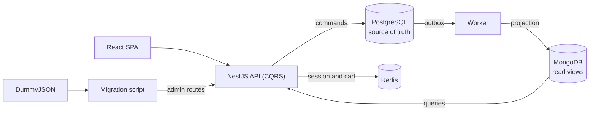

# Mercadummy: prototype documentation

E-commerce prototype with **CQRS** and three databases. There are two user roles, `admin` and shopper (`user`). It is not a marketplace. Categories and products come from [DummyJSON](https://github.com/Ovi/DummyJSON), and the system is in English.

These files are the **specification**. The API, the worker, the front end and the migration script have not been implemented yet. The PostgreSQL schema will be defined in `schema.prisma` and applied through Prisma migrations.

## Files

| File | What it proposes |
|---|---|
| `01-postgres-model.md` | write model: diagram, tables, constraints and rules the application must enforce; basis for `schema.prisma` |
| `02-dummyjson-extraction.md` | extraction of categories and products and the mapping of each parameter to the tables |
| `03-redis.md` | session and cart: keys, expiration, cookie, scripts, checkout, failures and configuration |
| `04-mongodb-model.md` | read views: collections, mapping, indexes, queries and updates by the worker |
| `05-mongodb-reprocessing.md` | instructions for rebuilding or fixing MongoDB |
| `06-api-contract.md` | API routes, access, requests, responses and errors |

**Suggested reading order:** `01`, `04`, `03` and `06`. Use `02` when building the migration and `05` when reprocessing the views.

## Data architecture

| Database | Responsibility | If the data is lost |
|---|---|---|
| PostgreSQL | users, catalog, orders and outbox | it is the source of truth; relies on backups |
| MongoDB | views shaped like the screens | can be rebuilt from PostgreSQL |
| Redis | sessions and carts | users log in again; carts are lost |

## Key decisions

- Business keys are **UUID v4**; `order_number` is the displayed order number, and `external_id` keeps the product's source id.
- The discount is stored as it comes from DummyJSON and rounded only in the view.
- The order **charges the full price**; the discounted total is also stored.
- Purely descriptive product attributes are kept in a single `jsonb` field. DummyJSON data not used in the project, such as reviews, shipping and return policies and `meta`, is discarded during import.
- An order is created as `CONFIRMED` at checkout and does not change afterwards; there is no order management by the administrator.
- The worker rereads the current state in PostgreSQL. Reprocessing does not depend on the event history.
- The migration is done by an external script, **through the API**, and does not change existing records.

## What has been verified

| Part | Verification | Still missing |
|---|---|---|
| PostgreSQL | schema in SQL, a test load of categories and products, and the projection and reprocessing SQL | `schema.prisma`, migrations and API transactions, such as checkout |
| Redis | scripts, expiration, out-of-memory and normal restart, on Redis 7.0.15 | abrupt crash and integration with the API |
| MongoDB | no execution; the server could not be obtained in the test environment | writes, queries, indexes, collection swap and rebuild |
| API and migration | the DummyJSON products were checked against the input rules | implementation and tests of the routes |

## Open points

| Point | Current status |
|---|---|
| Duplicate purchase in two tabs | noted in `03`; the Redis lock is not part of the design |
| Price charged | full price, as in the mockup; confirm whether the discount should be applied |
| First `admin` | define how to create the account; it is needed for the migration |
| Test user and order data | will be created later |
| Proposed values | session and cart expiration, stock ranges, route and worker limits |
| Multiple workers | the design assumes one; see the caveat about deletions in `04` |

## Adjustments to the source materials

The C4 diagrams, the mockups and `screens.md` served as input and are not part of this package. They should be updated:

- **C4, levels 1 and 2:** replace the Advertiser actor with the Administrator and revisit the mention of ads.
- **C4, level 3:** the session and cart component needs to read products from MongoDB, directly or through a query.
- **Mockups:** they are in Portuguese and use data different from DummyJSON's.
