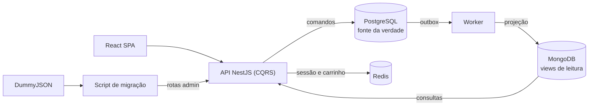

# Mercadummy: documentação do protótipo

Protótipo de e-commerce com **CQRS** e três bancos de dados. Há dois papéis de usuário, `admin` e comprador (`user`). Não é um marketplace. Categorias e produtos vêm do [DummyJSON](https://github.com/Ovi/DummyJSON), e o sistema é em inglês.

Estes arquivos são a **especificação**. A API, o worker, o front e o script de migração ainda não foram implementados.

## Arquivos

| Arquivo | O que propõe |
|---|---|
| `schema.sql` | DDL executável do PostgreSQL |
| `01-modelagem-postgres.md` | modelo de escrita: diagrama, tabelas, constraints e regras que a aplicação precisa garantir |
| `02-extracao-dummyjson.md` | extração de categorias e produtos e mapeamento de cada parâmetro para as tabelas |
| `03-redis.md` | sessão e carrinho: chaves, validade, cookie, scripts, checkout, falhas e configuração |
| `04-modelagem-mongodb.md` | views de leitura: coleções, mapeamento, índices, consultas e atualização pelo worker |
| `05-reprocessamento-mongodb.md` | instruções para reconstruir ou corrigir o MongoDB |
| `06-contrato-api.md` | rotas da API, acessos, requisições, respostas e erros |

**Ordem de leitura sugerida:** `01`, `04`, `03` e `06`. Use o `02` ao criar a migração e o `05` ao reprocessar as views.

## Arquitetura de dados

| Banco | Responsabilidade | Se os dados forem perdidos |
|---|---|---|
| PostgreSQL | usuários, catálogo, pedidos e outbox | é a fonte da verdade; depende de backup |
| MongoDB | views no formato das telas | pode ser reconstruído a partir do PostgreSQL |
| Redis | sessões e carrinhos | novo login; os carrinhos se perdem |

## Principais decisões

- Chaves de negócio em **UUID v4**; `order_number` é o número exibido do pedido, e `external_id` guarda o id de origem do produto.
- O desconto é gravado como vem do DummyJSON e arredondado apenas na view.
- O pedido **cobra o preço cheio**; o total com desconto também é gravado.
- Atributos apenas descritivos do produto ficam em um único campo `jsonb`.
- O worker relê o estado atual no PostgreSQL. O reprocessamento não depende do histórico de eventos.
- A migração é feita por um script externo, **através da API**, e não altera registros existentes.

## O que foi verificado

| Parte | Verificação | Ainda falta |
|---|---|---|
| PostgreSQL | esquema, carga de teste de categorias e produtos, e o SQL de projeção e reprocessamento | transações da API, como o checkout |
| Redis | scripts, validade, falta de memória e reinício normal, em um Redis 7.0.15 | queda abrupta e integração com a API |
| MongoDB | nenhuma execução; o servidor não pôde ser obtido no ambiente de testes | gravação, consultas, índices, troca de coleções e reconstrução |
| API e migração | os produtos do DummyJSON foram conferidos contra as regras de entrada | implementação e testes das rotas |

## Pontos em aberto

| Ponto | Situação atual |
|---|---|
| Compra duplicada em duas abas | ponto de atenção no `03`; a trava no Redis não faz parte do desenho |
| Preço cobrado | preço cheio, como no mockup; confirmar se o desconto deve ser aplicado |
| Primeiro `admin` | definir como criar a conta; é necessária para a migração |
| Dados de usuários e pedidos de teste | serão criados posteriormente |
| Tela do administrador | há rotas, mas o `screens.md` não define a tela |
| Valores propostos | validade da sessão e do carrinho, faixas de estoque, limites das rotas e do worker |
| Vários workers | o desenho considera um; ver a ressalva sobre exclusões no `04` |

## Ajustes nos materiais de origem

Os diagramas C4, os mockups e o `screens.md` serviram de entrada e não fazem parte deste pacote. Convém atualizar:

- **C4, níveis 1 e 2:** trocar o ator Anunciante pelo Administrador e rever a menção a anúncios.
- **C4, nível 3:** o componente de sessão e carrinho precisa ler os produtos do MongoDB, direto ou por uma consulta.
- **Mockups:** estão em português e usam dados diferentes dos do DummyJSON.
