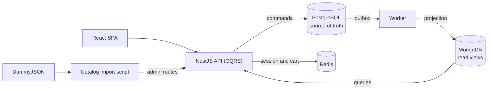

# Mercadummy: prototype documentation

E-commerce prototype with **CQRS** and three databases. There are two user roles, `admin` and shopper (`user`). It is not a marketplace. Categories and products come from [DummyJSON](https://github.com/Ovi/DummyJSON), and the system is in English.

This directory contains the backend architecture, the data model specifications, and the REST API contract.

## Files

| File | What it covers |
|---|---|
| [Backend Architecture](architecture.md) | Stack, module structure, request flow, transactions, and background processing |
| [API Contract](06-api-contract.md) | Routes, access rules, requests, responses, and errors |
| [PostgreSQL Model](01-postgres-model.md) | Write model, tables, constraints, and rules enforced by the application |
| [Redis](03-redis.md) | Sessions, cart operations, checkout, and failure handling |
| [MongoDB Model](04-mongodb-model.md) | Read projections, indexes, queries, and worker updates |
| [DummyJSON Extraction](02-dummyjson-extraction.md) | Extraction and mapping of categories and products for import |
| [MongoDB Reprocessing](05-mongodb-reprocessing.md) | Rebuilding and repairing projections |

Start with the backend architecture, then use the API contract and the data specifications relevant to your task.

## Data architecture

| Database | Responsibility | If the data is lost |
|---|---|---|
| PostgreSQL | users, catalog, orders and outbox | it is the source of truth; relies on backups |
| MongoDB | views shaped like the screens | can be rebuilt from PostgreSQL |
| Redis | sessions and carts | users log in again; carts are lost |

## Key decisions

- Business keys are **UUID v4**; `order_number` is the displayed order number, and `external_id` keeps the product's source id.
- The discount is stored as it comes from DummyJSON and rounded only in the view.
- The order **charges the full price**; the discounted total is also stored.
- Purely descriptive product attributes are kept in a single `jsonb` field. DummyJSON data not used in the project, such as reviews, shipping and return policies and `meta`, is discarded during import.
- An order is created as `CONFIRMED` at checkout and does not change afterwards; there is no order management by the administrator.
- The worker rereads the current state in PostgreSQL. Reprocessing does not depend on the event history.
- An external script imports the catalog **through the API** and leaves existing records unchanged.

## Open points

- Define how to create the first `admin` account, which is required to import the catalog.
- Confirm whether checkout should apply discounts. The current specification charges the full price.
- Confirm the proposed session and cart lifetimes, stock ranges, and API and worker limits.
- Known limitation: confirming checkout in two tabs with different idempotency keys can create two orders if stock is sufficient. See [Duplicate purchase](03-redis.md#note-duplicate-purchase).
