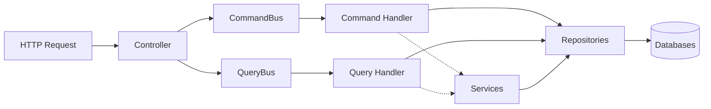
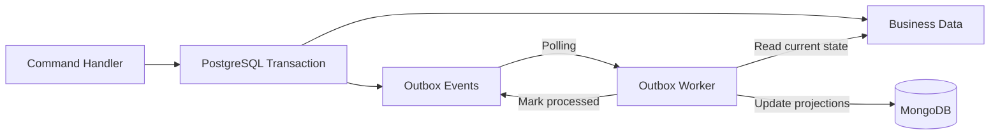

# Backend Architecture

## Stack

| Technology   | Responsibility                   |
| ------------ | -------------------------------- |
| Node.js      | Runtime                          |
| TypeScript   | Programming language             |
| NestJS       | Backend framework                |
| @nestjs/cqrs | Command and query handling       |
| Prisma       | PostgreSQL access and migrations |
| Mongoose     | MongoDB access and schemas       |
| node-redis   | Redis access                     |

## Architectural Overview

The backend is a modular NestJS application exposing a REST API.

CQRS separates operations that modify application state from operations that retrieve data through commands, queries, and their respective handlers.

| Database   | Responsibility                               |
| ---------- | -------------------------------------------- |
| PostgreSQL | Authoritative business data and transactions |
| MongoDB    | Read projections                             |
| Redis      | Sessions and shopping carts                  |

MongoDB projections are synchronized asynchronously through a Transactional Outbox.

## Directory Structure

```text
backend/
├── prisma/
│   ├── schema.prisma
│   └── migrations/
├── src/
│   ├── main.ts
│   ├── worker.ts
│   ├── rebuild.ts
│   ├── app.module.ts
│   ├── database/
│   │   ├── postgres/
│   │   ├── mongodb/
│   │   └── redis/
│   ├── auth/
│   ├── catalog/
│   ├── cart/
│   ├── orders/
│   └── projections/
├── .env.example
└── package.json
```

### Entrypoints

| File         | Responsibility                         |
| ------------ | -------------------------------------- |
| `main.ts`    | Start the REST API                     |
| `worker.ts`  | Start the Outbox Worker                |
| `rebuild.ts` | Execute the projection rebuild process |

The API and the worker run as independent processes within the same backend codebase.

The worker and the rebuild process reuse the projection logic defined in `projections/`.

### Business Modules

| Module    | Responsibility                                 |
| --------- | ---------------------------------------------- |
| `auth`    | User registration, authentication and sessions |
| `catalog` | Products, categories and catalog queries       |
| `cart`    | Shopping cart management                       |
| `orders`  | Checkout and order history                     |

Each module encapsulates its own functionality and dependencies through NestJS modules and providers.

### Module Organization

Organize components by business module, keeping related functionality, persistence operations, supporting functions, and tests together.

Each business module has a NestJS module definition. Its internal structure depends on its responsibilities and implementation requirements.

The following example illustrates the organization of an `orders` module. The files and directories shown are illustrative and do not constitute a mandatory implementation structure.

```text
orders/
├── orders.module.ts
├── orders.controller.ts
├── orders.dto.ts
├── order-totals.ts                  # Example of a pure function
├── order-totals.spec.ts             # Example of a unit test
├── commands/
│   └── place-order.ts               # Command and handler
├── queries/
│   └── list-my-orders.ts            # Query and handler
├── repositories/
│   ├── orders-postgres.repository.ts
│   └── orders-mongodb.repository.ts
└── schemas/
    └── order.schema.ts
```

- Keep commands under `commands/`, with each command and its handler in the same file.
- Keep queries under `queries/`, with each query and its handler in the same file.
- Keep repositories under `repositories/`.
- Keep Mongoose schemas under `schemas/`.
- Keep module-specific tests close to the code they validate.
- Introduce additional files and directories according to the module's actual requirements.

## Component Responsibilities

The following components represent the architectural building blocks of the backend. Each module adopts the components appropriate to its functionality and complexity.

| Component          | Responsibility                                                                                                                                         |
| ------------------ | ------------------------------------------------------------------------------------------------------------------------------------------------------ |
| Modules            | Register controllers and providers, declare dependencies, and expose providers to other modules through NestJS dependency injection.                   |
| Controllers        | Define HTTP routes, receive requests, dispatch commands and queries, and return responses.                                                             |
| DTOs               | Define API input and output structures and establish input validation rules.                                                                           |
| Commands           | Represent operations that modify application state, carrying the data required for their execution.                                                    |
| Queries            | Represent operations that retrieve application data, carrying the parameters required for their execution.                                             |
| Handlers           | Execute individual commands or queries, enforce business rules, and coordinate the repositories, services, and functions required by the operation.    |
| Services           | Encapsulate business logic that benefits from reuse, independent organization, or dependency injection. Implemented as NestJS providers when required. |
| Pure Functions     | Encapsulate deterministic calculations, transformations, and business rules independently of framework dependencies, external state, and side effects. |
| Repositories       | Encapsulate database-specific queries and persistence operations, separating data access from business logic.                                          |
| Models and Schemas | Define domain data structures and their persistence representations according to the requirements of each database.                                    |
| Guards             | Enforce authentication and authorization before controller operations are executed.                                                                    |
| Workers            | Execute asynchronous background operations independently of the HTTP request lifecycle.                                                                |

### Component Conventions

- Handlers coordinate individual application operations and may access repositories, services, and pure functions directly.
- Services encapsulate business logic when additional separation, reuse, or dependency injection provides a concrete benefit.
- Prefer pure functions for self-contained calculations and transformations that depend exclusively on their inputs.
- Repositories are concrete implementations specific to their persistence responsibilities.
- PostgreSQL models are defined in `prisma/schema.prisma`.
- MongoDB schemas are defined with Mongoose within their respective modules.
- Redis data structures are represented through TypeScript types and repository implementations.
- Authentication and authorization guards belong to the `auth` module and are reused by controllers that require access control.
- Background processing is centralized in `projections/`, which owns the Outbox Worker and projection rebuilding logic.

## Request Flow

Controllers dispatch commands through `CommandBus` and queries through `QueryBus`, provided by `@nestjs/cqrs`.



Handlers coordinate application operations and access repositories and services through NestJS dependency injection. Pure functions may be called directly whenever required by the operation.

## Database Access

Database connections and client initialization are centralized under `src/database/`.

### PostgreSQL

Use Prisma for relational data access.

The Prisma schema and migrations define the database structure, including the additional SQL required by the PostgreSQL model.

Schema and migration files are maintained under `backend/prisma/`.

### MongoDB

Use Mongoose for document schemas and collection access.

Repositories encapsulate queries and persistence operations against the read projections.

Projection writes are owned by the projection processing and rebuilding flows.

### Redis

Use node-redis for session and shopping cart operations.

Repositories encapsulate Redis keys, commands, expiration policies, and atomic operations.

### Repository Boundaries

Use concrete repositories specific to each module and database.

Repository methods should represent meaningful persistence operations required by the application.

Handlers and services coordinate operations involving multiple repositories.

## Transactions

Transaction boundaries are defined at the command handler or coordinating service level.

Repositories participating in the same PostgreSQL transaction must use the same Prisma transaction client.

During checkout, the following operations must be committed within a single PostgreSQL transaction:

- Order and order item creation.
- Stock validation and updates.
- Version increments.
- Corresponding outbox events.

Stock updates must preserve inventory consistency under concurrent purchases.

Redis cart cleanup occurs after the PostgreSQL transaction commits.

## Transactional Outbox

Business data and corresponding outbox events are persisted within the same PostgreSQL transaction.

The Outbox Worker runs independently from the API and processes pending events asynchronously.



The worker retrieves the current PostgreSQL state, updates the corresponding MongoDB projections, and records the event processing result.

Projection operations must support safe reprocessing.

The initial architecture uses a single worker process.

## Projections

The `src/projections/` directory contains the shared logic responsible for synchronizing PostgreSQL data with MongoDB read models.

Its responsibilities include:

- Reading authoritative data from PostgreSQL.
- Transforming relational data into document structures.
- Persisting MongoDB projections.
- Processing outbox events.
- Rebuilding projections.

The worker and the rebuild process must reuse the same transformation logic and projection definitions.

## Configuration

Database connections and environment-specific settings are provided through environment variables.

Document required variables in `backend/.env.example`.

Database connections support local installations, containers, and remote database services.

## Related Specifications

- [Backend Overview](README.md)
- [PostgreSQL Model](01-postgres-model.md)
- [DummyJSON Extraction](02-dummyjson-extraction.md)
- [Redis](03-redis.md)
- [MongoDB Model](04-mongodb-model.md)
- [MongoDB Reprocessing](05-mongodb-reprocessing.md)
- [API Contract](06-api-contract.md)
