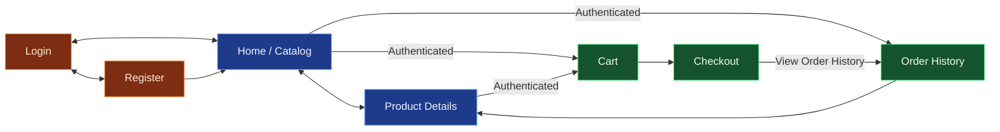

# Screens

## Routes

| Route           | Screen          | Access    | Responsibilities                                                                                                                                                                   |
| --------------- | --------------- | --------- | ---------------------------------------------------------------------------------------------------------------------------------------------------------------------------------- |
| `/`             | Home / Catalog  | `shared`  | Display products, search by name, filter by category and availability, and provide access to product details.                                                                      |
| `/products/$id` | Product Details | `shared`  | Display product images, description, price, specifications and stock availability. Allow authenticated users to add products to the cart.                                          |
| `/login`        | Login           | `public`  | Authenticate existing users and provide navigation to registration.                                                                                                                |
| `/register`     | Register        | `public`  | Allow visitors to create an account and access the application.                                                                                                                    |
| `/cart`         | Shopping Cart   | `private` | Display cart items, update quantities, remove products, calculate totals and proceed to checkout.                                                                                  |
| `/checkout`     | Checkout        | `private` | Review the order, confirm the purchase and display the processing result, including success or failure.                                                                            |
| `/orders`       | Order History   | `private` | List previous orders with date, status and total. Display order items with product thumbnail, title, quantity and price, including links to their respective product detail pages. |

`$id` represents a dynamic product identifier.

## Navigation

🟠 `public` · 🔵 `shared` · 🟢 `private`

## Navigation Behavior

- Unauthenticated access to a `private` route redirects to `/login`.
- Authenticated access to a `public` route redirects to `/`.
- Successful login or registration navigates to `/`.
- For visitors, selecting the cart control in the header opens a popover inviting them to log in or register.
- For visitors, attempting to add a product to the cart navigates to `/login`.
- Successful checkout displays an order confirmation on the checkout page.

## Optional Features

- **Price filtering:** Filter catalog products by price range.
- **Contextual redirect:** Return users to their intended destination after login or registration.
- **Profile management:** Allow users to edit their account information.
- **Product management:** Allow administrators to create, edit, and remove products.
- **Order management:** Allow customers to request changes to their orders.
- **Order status management:** Allow administrators to update order statuses.

## Shared Components

### Header

#### Responsibilities

Provide navigation to the catalog, shopping cart, order history, and authentication screens.

#### Components

- **Logo:** Navigate to `/`.
- **Login:** Navigate to `/login`.
- **Register:** Navigate to `/register`.
- **Cart:** Navigate to `/cart` for authenticated users. For visitors, open a popover inviting them to log in or register.
- **Order History:** Navigate to `/orders`.
- **Logout:** End the current session and navigate to `/`.

#### Layout

- Logo aligned to the left.
- Navigation actions aligned to the right.
- Compact layout with icons on smaller screens.

#### Visibility

| Element       | Visitor | Authenticated | Login Screen | Register Screen |
| ------------- | ------- | ------------- | ------------ | --------------- |
| Logo          | Visible | Visible       | Visible      | Visible         |
| Login         | Visible | Hidden        | Hidden       | Visible         |
| Register      | Visible | Hidden        | Visible      | Hidden          |
| Cart          | Visible | Visible       | Hidden       | Hidden          |
| Order History | Hidden  | Visible       | Hidden       | Hidden          |
| Logout        | Hidden  | Visible       | Hidden       | Hidden          |

#### Interactions

- Clicking the logo navigates to the Home / Catalog.
- Visitors clicking the cart open an authentication popover with Login and Register options.
- Authenticated users clicking the cart navigate to `/cart`.
- Clicking Order History navigates to `/orders`.
- Clicking Logout ends the session and navigates to `/`.

## Screen Specifications

### Home / Catalog

**Route:** `/`
**Access:** `shared`

#### Responsibilities

Display the product catalog and allow users to search, filter, and browse products.

#### Components

- **Search:** Search products by name.
- **Availability filter:** Show all products or only products in stock.
- **Category filter:** Allow users to filter products by category.
- **Product grid:** Display products in a responsive grid.
- **Product cards:**
  - Thumbnail.
  - Title.
  - Price.
  - Category.
  - Rating.
  - Discount.
  - Stock availability.
- **Load More:** Load additional products into the existing grid.

#### Layout

- Search field above the catalog.
- Left sidebar with availability filter followed by categories.
- Category list in a scrollable area with limited height.
- Product grid to the right of the sidebar.
- Load More button below the product grid.

#### Interactions

- Selecting a product opens `/products/$id`.
- Searching or changing filters updates the product list and resets incremental loading.
- Clicking Load More appends the next set of products.

#### UI States

- **Loading:** Products are being fetched.
- **Empty:** No products match the current search or filters.
- **Error:** Product loading fails, with an option to retry.

### Product Details

**Route:** `/products/$id`
**Access:** `shared`

#### Responsibilities

Display detailed product information and allow users to select a quantity and add the product to their shopping cart.

#### Components

- **Image gallery:** Display product images, allowing users to navigate between available images.
- **Product information:**
  - Title.
  - Category.
  - Price.
  - Discount.
  - Rating.
  - Stock availability.
- **Quantity selector:** Editable numeric field with increment and decrement buttons.
- **Add to Cart:** Add the selected quantity to the shopping cart.
- **Description:** Display the product description.
- **Specifications:** Display additional product attributes when available.

#### Layout

- Image gallery on the left.
- Product information and purchase controls on the right.
- Description and specifications below the main product section.
- Stacked layout on smaller screens.

#### Interactions

- Selecting an image thumbnail updates the main image.
- Users can adjust the desired quantity using the numeric field or increment and decrement buttons.
- Authenticated users can add the selected quantity to their cart.
- Visitors attempting to add a product to their cart are redirected to `/login`.

#### UI States

- **Loading:** Product information is being fetched.
- **Not Found:** The requested product does not exist.
- **Out of Stock:** The product is unavailable for purchase.
- **Error:** Product loading fails, with an option to retry.
- **Success:** The selected quantity is successfully added to the cart.

### Login

**Route:** `/login`
**Access:** `public`

#### Responsibilities

Allow existing users to authenticate using their email and password.

#### Components

- **Email:** Input field for the user's email address.
- **Password:** Password input field.
- **Login:** Submit the authentication form.

#### Layout

- Centered authentication form.
- Input fields stacked vertically.
- Login button below the fields.
- Responsive layout for smaller screens.

#### Interactions

- Submitting valid credentials authenticates the user and navigates to `/`.
- Authenticated users accessing `/login` are redirected to `/`.

#### UI States

- **Loading:** Authentication is being processed.
- **Error:** Authentication fails, displaying an appropriate message.

### Register

**Route:** `/register`
**Access:** `public`

#### Responsibilities

Allow visitors to create an account using their full name, email, and password.

#### Components

- **Full Name:** Input field for the user's full name.
- **Email:** Input field for the user's email address.
- **Password:** Password input field.
- **Confirm Password:** Password confirmation field.
- **Register:** Submit the registration form.

#### Layout

- Centered registration form.
- Input fields stacked vertically.
- Register button below the fields.
- Responsive layout for smaller screens.

#### Interactions

- Successful registration authenticates the user and navigates to `/`.
- Invalid information displays validation errors.
- Authenticated users accessing `/register` are redirected to `/`.

#### UI States

- **Loading:** Registration is being processed.
- **Error:** Registration fails, displaying an appropriate message.

### Shopping Cart

**Route:** `/cart`
**Access:** `private`

#### Responsibilities

Allow users to review their shopping cart, update product quantities, remove items, and proceed to checkout.

#### Components

- **Cart items:**
  - Product thumbnail.
  - Product title.
  - Unit price.
  - Quantity selector with an editable numeric field and increment/decrement buttons.
  - Remove button.
- **Order Summary:**
  - Total item quantity.
  - Total price.
  - Proceed to Checkout button.

#### Layout

- Two-column layout on desktop.
  - Left column (70%) displays cart items.
  - Right column (30%) displays the Order Summary.
- Single-column layout on smaller screens, with the Order Summary below the cart items.

#### Interactions

- Selecting a product opens `/products/$id`.
- Users can update product quantities using the numeric field or increment/decrement buttons.
- Users can remove products from the cart.
- Quantity changes exceeding available stock display an appropriate message.
- Clicking Proceed to Checkout navigates to `/checkout`.

#### UI States

- **Loading:** Cart information is being fetched.
- **Empty:** The cart contains no products, with an option to return to the catalog.
- **Error:** A cart operation fails, displaying an appropriate message.

### Checkout

**Route:** `/checkout`
**Access:** `private`

#### Responsibilities

Allow users to review and confirm their orders, displaying the processing result.

#### Components

- **Order items:**
  - Product thumbnail.
  - Product title.
  - Unit price.
  - Quantity.
- **Order Summary:**
  - Total item quantity.
  - Total price.
  - Confirm Order button.
- **Back to Cart:** Navigate to `/cart`.

#### Layout

- Two-column layout on desktop.
  - Left column displays the order items.
  - Right column displays the Order Summary.
- Single-column layout on smaller screens, with the Order Summary below the items.

#### Interactions

- Order items and quantities are displayed as read-only information.
- Clicking Back to Cart navigates to `/cart`.
- Clicking Confirm Order submits the order for processing.
- Successful orders display a confirmation on the same page, with an option to navigate to `/orders`.
- Failed orders display an appropriate error message.

#### UI States

- **Loading:** Order information is being fetched.
- **Processing:** Order confirmation is being processed.
- **Success:** Order is confirmed successfully.
- **Error:** Order processing fails, displaying an appropriate message.

### Order History

**Route:** `/orders`
**Access:** `private`

#### Responsibilities

Allow users to view their previous orders and inspect the products included in each order.

#### Components

- **Order list:** Display orders from most recent to oldest.
- **Order cards:**
  - Order identifier.
  - Date and time.
  - Status.
  - Total item quantity.
  - Total price.
- **Expandable order details:**
  - Product thumbnail.
  - Product title.
  - Unit price at the time of purchase.
  - Quantity purchased.

#### Layout

- Vertical list of order cards.
- Each card displays an order summary and can be expanded to reveal its products.
- Responsive layout for smaller screens.

#### Interactions

- Clicking an order card expands or collapses its details.
- Selecting a product thumbnail or title opens `/products/$id`.

#### UI States

- **Loading:** Order history is being fetched.
- **Empty:** No previous orders are available, with an option to return to the catalog.
- **Error:** Order history loading fails, with an option to retry.
